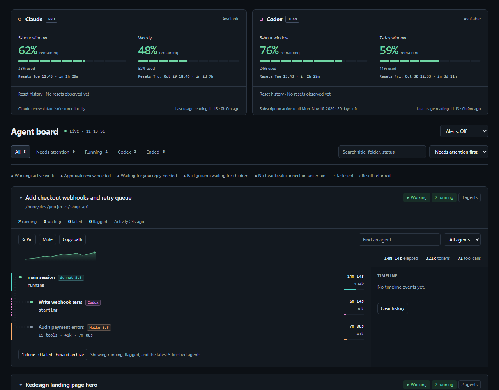

# agent-board

```text
/plugin install agent-board --marketplace 66Hamidreza/claude-code-mods
```

Observes the main session, subagents, workflow agents, Codex exec runs, and standalone Codex main threads and their delegated children driven by T3 Code. Shows model, current tool, recent calls, errors, tokens, duration, and heuristic health indicators in a terminal pane and a local web board.



## Commands

- `/board`: open the pane.
- `/board web`: start the board at `http://localhost:7788/` for all local sessions (static fallback server, no usage header; see Always-on web board).
- `/board notify on` / `/board notify off`: persist the native-notification preference; toasts remain enabled.
- `/board clear`: remove finished non-main nodes and clear event history.

The pane also offers controls for finished agents and history. The web board supports filtering, search, pinning and collapse, with browser-local preferences and opt-in browser alerts.

## Configuration and operation

`HOME` locates `~/.claude/mods-data/agent-board/web` and `~/.codex/sessions`. Polls agent state every second and writes session snapshots for the web board. OpenCode sessions are read directly from `~/.local/share/opencode/opencode.db` (`session_v2`) in read-only mode; child sessions are nested by `parent_id`, and busy means `time_busy > time_idle` with an update within 10 minutes. Inside T3 Code, delegated children are read from `~/.t3/userdata/statev2.sqlite` (read-only, matched to the session by its provider thread id). Python 3 reads recent Codex rollout logs and serves static files bound to `127.0.0.1:7788`. Explicit `CX_RUN_V1` owner/run markers attribute delegated jobs; interactive Codex TUI sessions are excluded. The always-on server independently scans T3 Code Codex main rollouts and attaches their app-owned delegated children, including Claude children, from T3's projections. CX-marked runs are excluded; child native IDs are excluded as separate mains. Orchestration advice from prompt-router is compared with observed execution.

## Usage header

The header shows remaining Claude and Codex quota, reset countdowns, reset credits and reported renewal dates. Claude uses a cached read-only usage API request with local T3 logs as a fallback. Codex windows come from recent rollout observations; the newest event timestamp wins and future timestamps are ignored. Past or old readings are marked stale and do not show a current remaining percentage. A past renewal date means renewal status is unknown, not that the subscription has ended. No credential is returned to the browser.

Windows-side T3 threads are discovered read-only when running in WSL. Set `AGENT_BOARD_WINDOWS_HOME` to select a Windows profile, and optionally `AGENT_BOARD_WINDOWS_LABEL` for its display label. Per-agent usage uses provider context readings when present, otherwise the identified Claude or Codex log. Missing readings show `—`; an observed zero remains `0`. Context readings and cumulative log totals have different provider-specific meanings and should not be compared as identical billing totals.

## Always-on web board

Optional: serve the board without any session open. Copy `agent-board-web.service` to `~/.config/systemd/user/` (it runs `server.py`; adjust the path to where the mod is installed), then `systemctl --user enable --now agent-board-web`. It serves the static files plus `/usage.json` (Claude and Codex limits left, read from T3's provider logs, Codex rollouts and the Codex plan dates; renewal dates are reported observations, not proof of current subscription status). The `/board web` fallback server has no `/usage.json`. Claude session data comes from snapshots live sessions write. Standalone T3 Code Codex rows and their delegated children are discovered independently via `/codex-sessions.json`, so they appear without any Claude session or mod hook running. The server serves the installed `hooks/web.ts` page directly. The scanner checks all day directories for rollouts modified within two hours, caches unchanged files, and shows project, model, last action and token totals. `task_complete` (or an aborted turn) marks the main done; `task_started` resumes running, with five minutes of log silence treated as idle. Running or waiting children keep the session active after its main finishes. T3 mappings, child status, model, effort and approval/input waits are read-only and refreshed each scan, even if rollouts have not changed. Child activity uses stored timestamps, not poll time. Child nodes do not require child rollouts. Their token counts come from the child's own Codex rollout (within the two-hour scan window) or Claude transcript under `~/.claude/projects`, and stay zero when neither is found; command counts are unavailable. The T3 thread identity lets the web board deduplicate matching hook-driven child sessions; multiple main rollouts for one T3 thread produce one standalone row. If an existing T3 database cannot be queried, the scanner retains its last good result (or returns no rows before its first successful scan) until it recovers. Install `server.py` and `hooks/codex_standalone.py` alongside the updated `hooks/web.ts`, then restart the service. Terminal panes continue to show hook-driven sessions and children. `/board web` copes with the port already being served.

در حالت همیشه‌فعال، فرزندان واگذارشدهٔ T3 (Codex یا Claude) از پایگاه دادهٔ فقط‌خواندنی زیر نشست اصلی Codex نمایش داده می‌شوند و به هوک یا لاگ مستقل فرزند نیاز ندارند. لاگ فرزند به‌عنوان نشست اصلی جداگانه نمایش داده نمی‌شود. وضعیت، مدل، سطح تلاش و انتظار تأیید یا ورودی در هر اسکن تازه می‌شوند؛ توکن فرزند از لاگ rollout خود Codex (در بازهٔ اسکن دو ساعته) یا transcript خود Claude خوانده می‌شود و اگر هیچ‌کدام نبود صفر می‌ماند؛ تعداد فرمان در دسترس نیست. پس از پایان نشست اصلی، فرزند فعال نشست را باز نگه می‌دارد. اسکنر همهٔ پوشه‌های روزانه را برای لاگ‌های تغییرکرده در دو ساعت اخیر بررسی می‌کند و پنج دقیقه سکوت را بیکار محسوب می‌کند. اگر پایگاه موجود قابل خواندن نباشد، آخرین نتیجهٔ معتبر حفظ می‌شود؛ پیش از نخستین اسکن موفق، خروجی خالی است.

## Look and layout

The web board uses a mission-control theme: glass panels on a dark grid backdrop, a fluid layout that adapts from phones to ultrawide screens (container queries; two session columns above 2400px), and Claude and Codex logos on usage cards and agents. Each agent is a unit with a state pill (ACTIVE, STANDBY, APPROVAL, IDLE, DONE, FAULT): active units pulse, show an activity meter and a light sweep, idle ones breathe dimly, finished ones are greyed. Flow lines run between ports beside each status dot in two lanes: cyan arrows for tasks sent down, pink arrows for results returned up, grey for inferred links, with moving particles on fresh traffic (at most three per session). All motion stops under `prefers-reduced-motion`.

## Web board behavior

Sessions are served from `/sessions.json` (written atomically; a heartbeat keeps live sessions from vanishing). The list stays stable: rows are not reordered by timestamp churn, severity changes are debounced, and a session missing from a poll is kept briefly before it is dropped. Ended sessions are hidden from All, Needs attention, Running and Codex; they appear only under the Ended filter (pinned sessions always stay). Browser alerts fire on state transitions only. Real delegate/result/peer-message links are drawn between agents and sessions. Within each agent tree, the main stays first and siblings appear newest-created first, with descendants kept under their parent. Usage cards show each window’s observation time. Readings older than 6 hours or past their scheduled reset are marked stale; their historical used percentage remains available in the details, while the header withholds the current remaining percentage. The footer shows reset credits and the last reported renewal date; a past billing date means renewal status is unknown. Codex reads its usage API with the existing login, cached for 60 seconds; the newest timestamped rollout reading is the fallback. Failed requests preserve the last successful observation time, so old data still becomes stale. Reset history uses provider observation times and ignores older or repeated observations. Early resets require an observed usage drop of at least 10 percentage points or more than half; clock changes alone do not confirm a reset. Confirmed resets have a badge, dismissible banner and per-window history. Older poll-time histories are discarded when the new observation-based history starts; the Codex card also shows available rate-limit reset credits (read-only fetch every five minutes).


For a friendlier local name, add `127.0.0.1 abd` to your hosts file (on WSL with a Windows browser: `C:\Windows\System32\drivers\etc\hosts`, as administrator) and open `http://abd:7788/`. The server accepts only `localhost`, `127.0.0.1` and `abd` as `Host` values.

## Limits

Health flags are heuristics (repeated calls, repeated failures, inactivity), not proof of failure. Quiet or long-running work may be flagged. Codex parsing depends on rollout formats and scans recent day folders. The fixed port must be available; another server may already own it. Automatic browser opening tries `cmd.exe`; on other systems open the URL manually. Desktop notifications depend on host/OS support. Snapshots and logs can include command text, paths, and summaries; the local server has no authentication and exposes files in its web directory to local clients.

[Installation and development](../README.md) · [راهنمای فارسی](../docs/fa/agent-board.md)
