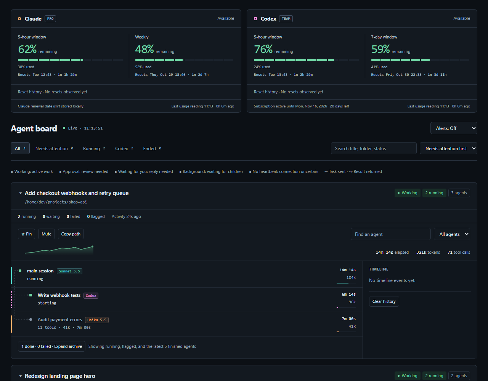

<div dir="rtl">

# تابلوی عامل‌ها

agent-board نشست اصلی، عامل‌های فرعی، عامل‌های گردش‌کار و اجرای Codex را رصد می‌کند: مدل، ابزار جاری، فراخوانی‌های اخیر، خطاها، توکن‌ها، زمان و نشانه‌های احتمالی مشکل.

## فرمان‌ها

| فرمان | کارکرد |
| --- | --- |
| `/board` | باز کردن پنل ترمینال |
| `/board web` | راه‌اندازی داشبورد محلی برای همهٔ نشست‌ها |
| `/board notify on` | فعال کردن اعلان بومی و ذخیرهٔ ترجیح |
| `/board notify off` | غیرفعال کردن اعلان بومی؛ پیام‌های گذرا باقی می‌مانند |
| `/board clear` | حذف عامل‌های پایان‌یافتهٔ غیر اصلی و پاک کردن تاریخچهٔ رویدادها |

نمونه:

</div>

```text
/board web
/board notify off
```

<div dir="rtl">

نشانی داشبورد `http://localhost:7788/` است. اگر مرورگر خودکار باز نشد، آن را دستی باز کنید. صفحهٔ وب جست‌وجو، فیلتر، سنجاق و جمع کردن بخش‌ها دارد؛ ترجیح‌های نمایشی در مرورگر ذخیره می‌شوند. اعلان مرورگر اختیاری است.



## نوار مصرف

بالای صفحهٔ وب، دو کارت مصرف نشان می‌دهد چه مقدار از سقف Claude و Codex باقی مانده است (پنجرهٔ ۵ ساعته و هفتگی، شمارش معکوس تا ریست) و تاریخ پایان اشتراک Codex. `server.py` این را فقط از فایل‌های محلی و هنگام درخواست می‌سازد: Claude از رویدادهای `rate_limit_event` در لاگ‌های T3 Code، Codex از جدیدترین rollout در `~/.codex/sessions` و تاریخ پلن از claimهای ID token. هیچ توکنی برگردانده نمی‌شود. تاریخ تمدید Claude روی دیسک ذخیره نمی‌شود و «در دسترس نیست» نشان داده می‌شود. دادهٔ Claude فقط وقتی تازه می‌شود که یک نشست T3 فعال باشد؛ زمان آخرین به‌روزرسانی روی کارت است.

## نمایش کارهای واگذارشده در T3

داخل T3 Code، فرزندهای `delegate_task` (مدل، effort، وضعیت، نتیجه) از پایگاه دادهٔ محلی T3 به‌صورت فقط‌خواندنی خوانده می‌شوند و کنار عامل‌ها دیده می‌شوند. عنوان رشتهٔ T3 نام نشست می‌شود و رشته‌های فرزند زیر پدرشان می‌آیند. نشست ساکتی که کار نمی‌کرد «پایان‌یافته» نشان داده می‌شود، نه «نیازمند توجه».

## اجرای همیشگی وب

برای دیدن تابلو بدون نشست باز: فایل `agent-board-web.service` را در `~/.config/systemd/user/` بگذارید (مسیر `ExecStart` را به محل نصب مود تنظیم کنید) و `systemctl --user enable --now agent-board-web` را بزنید. این سرویس فایل‌های وب و `/usage.json` را سرو می‌کند؛ دادهٔ نشست‌ها همچنان از اسنپ‌شات نشست‌های باز می‌آید. فرمان `/board web` سرور ساده‌ی بدون نوار مصرف را بالا می‌آورد.

## تنظیمات و روش کار

متغیر محیطی اختصاصی ندارد؛ HOME مسیر داده‌ها را تعیین می‌کند. اسنپ‌شات‌ها در `~/.claude/mods-data/agent-board/web` و لاگ‌های Codex در `~/.codex/sessions` خوانده می‌شوند. وضعیت عامل‌ها هر ثانیه بررسی می‌شود. Python 3 لاگ‌ها را می‌خواند و فایل‌های وب را فقط روی نشانی محلی 127.0.0.1 و پورت ثابت 7788 سرو می‌کند.

شناسهٔ مالک و اجرا در نشانگر `CX_RUN_V1` باعث انتساب کار واگذارشده به نشست می‌شود؛ نشست تعاملی Codex TUI کنار گذاشته می‌شود. پیشنهادهای prompt-router با اجرای مشاهده‌شده مقایسه می‌شوند.

## رفتار داشبورد وب

نشست‌ها از `/sessions.json` خوانده می‌شوند (نوشتن اتمیک و heartbeat برای جلوگیری از ناپدید شدن نشست‌های زنده). لیست پایدار می‌ماند: ترتیب ردیف‌ها با تغییر زمان جابه‌جا نمی‌شود، تغییر شدت با تأخیر اعمال می‌شود و نشستی که در یک poll نبود مدتی نگه داشته می‌شود. نشست‌های پایان‌یافته (Ended) از All، Needs attention، Running و Codex پنهان‌اند و فقط زیر فیلتر Ended دیده می‌شوند (نشست‌های سنجاق‌شده همیشه می‌مانند). اعلان مرورگر فقط هنگام تغییر وضعیت می‌آید. خطوط واقعی واگذاری، نتیجه و پیام بین عامل‌ها و نشست‌ها نمایش داده می‌شوند. کارت‌های مصرف زمان ریست را نشان می‌دهند و ریست زودهنگام یا برنامه‌ریزی‌نشده (افت ۱۰٪ یا بیشتر، یا جابه‌جایی ساعت پیش از موعد) را با نشان، بنر قابل‌بستن و تاریخچهٔ هر پنجره اعلام می‌کنند؛ کارت Codex ریست‌های موجود را هم نشان می‌دهد (خواندن فقط‌خواندنی هر پنج دقیقه).

برای نام محلی کوتاه، خط `127.0.0.1 abd` را به فایل hosts اضافه کنید (در WSL با مرورگر ویندوز: `C:\Windows\System32\drivers\etc\hosts` با دسترسی ادمین) و `http://abd:7788/` را باز کنید. سرور فقط `localhost`، `127.0.0.1` و `abd` را به‌عنوان Host می‌پذیرد.

## محدودیت‌ها

تکرار فراخوانی، خطا و بی‌فعالیتی فقط قرینه‌اند، نه اثبات گیرکردن. کار آرام یا طولانی ممکن است علامت بخورد. خواندن Codex به قالب لاگ و پوشه‌های روزهای اخیر وابسته است. پورت باید آزاد باشد؛ سرور دیگری ممکن است آن را گرفته باشد. باز کردن خودکار مرورگر با cmd.exe امتحان می‌شود و در سیستم‌های دیگر ممکن است لازم باشد دستی باز کنید. اعلان بومی به میزبان و سیستم‌عامل وابسته است.

اسنپ‌شات‌ها ممکن است متن دستور، مسیر و خلاصهٔ کار را داشته باشند. سرور محلی احراز هویت ندارد و فایل‌های پوشهٔ وب را در اختیار کاربران محلی قرار می‌دهد.

[نصب](index.md) · [راهنمای انگلیسی](../../agent-board/README.md)

</div>
